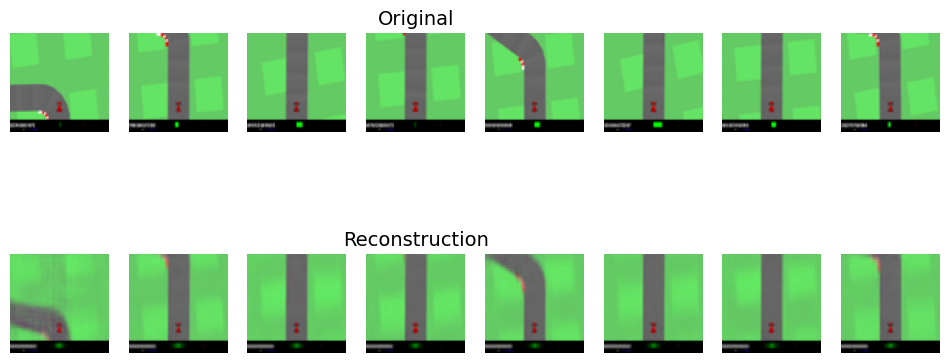
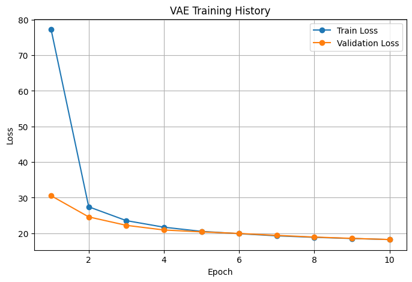
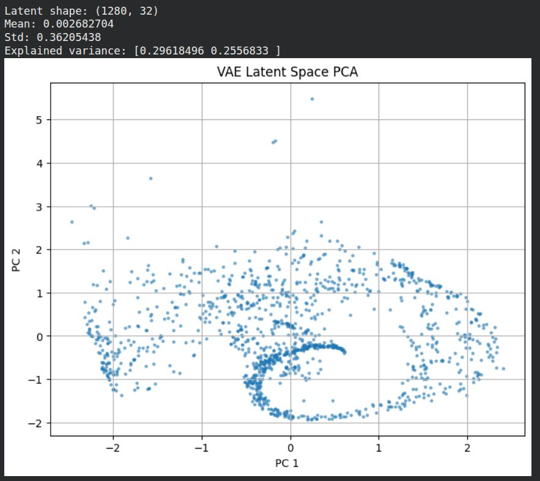

# Learning Compact Predictive World Models for Visual Control

A visual world-modeling project for the CarRacing environment focused on learning compact representations, predicting future latent states, and making those predictions easier to visualize and interpret.

The project follows this pipeline:

**pixels → VAE → MDN-RNN → controller**

## Project goal

The goal is to study how an agent can compress visual observations into a compact latent representation, learn how that latent state changes over time under different actions, and use those predictions for sequential decision-making.

A key focus is interpretability: predicted latent states can be decoded back into images and compared with actual future observations, making it possible to inspect where the model predicts well and where errors accumulate.

## Current progress

- [x] Collect CarRacing trajectories
- [x] Train/validation dataset pipeline
- [x] Convolutional VAE
- [x] VAE checkpointing and reconstruction evaluation
- [ ] MDN-RNN latent dynamics model
- [ ] Controller
- [ ] Multi-step latent rollouts and evaluation

## VAE results

The VAE compresses each **64×64 RGB frame** into a **32-dimensional latent vector** and reconstructs the observation from that representation.

### Reconstructions



### Training history



### Latent Space


## Repository

```text
src/
├── data/
│   ├── collect.py
│   ├── dataset.py
│   ├── encode_dataset.py
│   └── rnn_dataset.py
├── models/
│   ├── vae.py
│   └── rnn.py
├── training/
│   ├── train_vae.py
│   └── train_rnn.py
└── visualization/
    ├── view_episode.py
    └── visualize_vae.py
notebooks/
└── VAE_final.ipynb
assets/
```

The RNN dataset, model, and training files are placeholders for the next stage.
Each Python package also contains an `__init__.py` file.

Run commands from the repository root so imports and relative data paths resolve:

```bash
python -m src.data.collect
python -m src.data.dataset
python -m src.visualization.view_episode
```

The episode viewer expects `episode.npz` in the working directory and writes `ep.gif`.
Training, encoding, and VAE visualization expose functions to import:

```python
from src.training.train_vae import train
from src.data.encode_dataset import encode_dataset
from src.visualization.visualize_vae import show_checkpoint_reconstructions
```

The notebook in `notebooks/VAE_final.ipynb` runs in Colab and changes to the
cloned repository root before importing these packages. For local notebook use,
set the working directory to the repository root before running imports.

## Research direction and paper credit

This project is a from-scratch reimplementation of **[World Models](https://arxiv.org/abs/1803.10122)** by David Ha and Jürgen Schmidhuber (2018). The original paper introduced the VAE + MDN-RNN + controller framework that this project follows. My implementation is focused on understanding each component directly, reproducing the core pipeline in CarRacing, and then examining the learned latent representations and visual predictions to better understand where the model succeeds and where prediction errors accumulate.

The next stage is to learn action-conditioned latent dynamics with an MDN-RNN, then evaluate how accurately predicted latent states can be rolled forward and decoded into visual future observations.

## Keywords

World models, variational autoencoder (VAE), mixture density network recurrent neural network (MDN-RNN), explainable AI, latent dynamics, representation learning, visual control.
